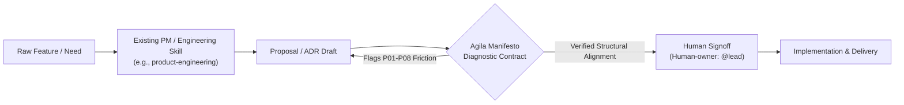

# Agila Manifesto — Agent & Ecosystem Integration Strategy

> **Status**: Architectural Plan & Integration Specification  
> **Target Audience**: AI Agent Developers, Platform Engineers, Orchestration Harness Maintainers, and Engineering Leaders.

---

## 1. Executive Summary: The Manifesto as a Cross-Cutting Contract

The **Agila Manifesto v3.1** is not a project management framework, a sprint methodology, or a replacement for existing engineering skills. It is an **orthogonal socio-technical contract** and a suite of **analytical diagnostic lenses** grounded in Conway's Law, queueing theory (Little's Law), cybernetic variety (Ashby's Law), and systems science.

### The Problem It Solves in AI-Assisted Engineering
As autonomous AI agents, coding assistants, and multi-agent harnesses take on larger software tasks, they often generate code that is syntactically correct and passes unit tests, yet introduces severe socio-technical failures:
1. **Conway Violations (P01)**: Generating microservices or component splits that span multiple human team boundaries without an established communication path.
2. **Cognitive Context Blowup (P02)**: Expanding a single module's surface until no human engineer or subagent can hold its domain model in context.
3. **Unpacted Coupling & Leaky Boundaries (P03, P04)**: Changing observable side effects or creating implicit dependencies across team interfaces (Hyrum's Law).
4. **Handoff Queue Explosions (P06)**: Introducing multi-stage dependencies that stall flow across organizational handoffs.
5. **Orphan Machine Artifacts (P08)**: Code or architectural configurations committed by AI agents that lack an identified human owner or clear boundary pacts.

### The Interoperability Model
The Agila Manifesto integrates as a **non-invasive, complementary evaluation lens**. It does not replace existing instructions (such as product discovery, TDD, linting, or CI pipelines); instead, it acts as an **advisory architectural contract** during technical proposals, system design evaluations, and review gates.



---

## 2. Analysis of Target Environments & Installation Mechanisms

Different agent environments use distinct configuration formats, skill conventions, and execution lifecycles. Below is an evidence-based assessment of the real extensibility mechanisms across the four primary target environments.

---

### 2.1 Claude Code (`claude` CLI)

#### Extensibility Architecture
- **Skill Discovery**: Claude Code searches for skills in directory trees containing `SKILL.md` files:
  - Project level: `.claude/skills/<skill-name>/SKILL.md`
  - Global user level: `~/.claude/skills/<skill-name>/SKILL.md`
- **Specification**: YAML frontmatter (`name`, `description`) followed by markdown instructions. Claude Code parses the frontmatter and dynamically exposes the skill to the model context when relevant tasks are triggered.
- **Model Context Protocol (MCP)**: Claude Code natively supports external tool and resource discovery via `claude mcp add`.

#### Recommended Installation
To install the English skill into any local project:
```bash
# In the root of your project
mkdir -p .claude/skills/agila-manifesto
curl -sSL https://raw.githubusercontent.com/willkwolf/agila-manifesto/main/skills/agila-manifesto-en/SKILL.md \
  -o .claude/skills/agila-manifesto/SKILL.md
```

#### How It Executes
When the developer asks Claude Code to *"review this proposed microservice split"* or *"draft an architecture proposal"*, the skill's description triggers automatic inclusion. Claude Code applies the 4-verb protocol (`read`, `analyze`, `cite`, `propose`) and outputs non-binding recommendations referencing specific principle IDs (e.g. `P01`, `P03`).

---

### 2.2 Google Antigravity

#### Extensibility Architecture
- **Workspace & Built-in Skills**: Antigravity automatically indexes skills placed in:
  - Workspace: `.gemini/antigravity/skills/<skill-name>/SKILL.md`
  - Global: `~/.gemini/antigravity/skills/` or bundled within `plugins/`
- **Rules Engine**: Rules in `.gemini/antigravity/rules/*.md` or `AGENTS.md` at workspace roots are loaded into the system prompt across every agent turn.
- **Subagent & Swarm Coordination**: Antigravity natively supports parallel worker swarms and reviewer agents communicating over a message board.

#### Recommended Installation
Place the skill directly in the workspace configuration:
```powershell
New-Item -ItemType Directory -Force -Path ".gemini/antigravity/skills/agila-manifesto"
Invoke-WebRequest -Uri "https://raw.githubusercontent.com/willkwolf/agila-manifesto/main/skills/agila-manifesto-en/SKILL.md" `
  -OutFile ".gemini/antigravity/skills/agila-manifesto/SKILL.md"
```

#### Packaging as an Antigravity Plugin
For multi-repository distribution, the Agila Manifesto can be packaged as a standalone plugin containing:
```text
agila-manifesto-plugin/
├── plugin.json               # Plugin metadata and dependencies
├── skills/
│   └── agila-manifesto/SKILL.md
└── rules/
    └── AGENTS.md             # Automatic architectural lens for all coding agents
```

---

### 2.3 OpenAI Codex, ChatGPT & Developer Tooling

#### Extensibility Architecture
- **Codex CLI & Assistants API**: Modern OpenAI-compatible developer harnesses (Cursor, Windsurf, OpenCode) discover repository instructions via `AGENTS.md` and `llms.txt`.
- **ChatGPT & Custom GPTs**: Knowledge retrieval via direct document ingest (`canon/manifesto.eo.yaml` or markdown summaries) paired with custom system instructions.
- **OpenAPI / MCP Integration**: Machine-readable schemas from `canon/manifesto.eo.yaml` can be served via a lightweight MCP server or REST endpoints for function calling.

#### Recommended Installation
For developer environments (Cursor / Windsurf / Codex):
1. Ingest [`AGENTS.md`](../../AGENTS.md) at the repository root.
2. Ingest [`llms.txt`](../../llms.txt) for compact, token-efficient model context.
3. For programmatic validation, configure linters to query [`canon/manifesto.eo.yaml`](../../canon/manifesto.eo.yaml).

---

### 2.4 OpenHarness (`oh`)

#### Extensibility Architecture
- **Agent Execution Loop**: OpenHarness wraps LLMs with an operational loop managing tool-calling, safety limits, streaming, and persistent memory.
- **Skills & Plugins**: Supports dynamic `.md` skill loading, project-level instruction files (`CLAUDE.md`, `AGENTS.md`), and MCP servers.
- **Governance & Pre/Post Execution Hooks**: Provides a hook system that intercepts tool calls before or after execution, allowing permission enforcement.

#### Viability & Implementation
OpenHarness is **exceptionally well-suited** for the Agila Manifesto. In addition to loading `SKILL.md`, OpenHarness's hook system allows programmatic enforcement of **Principle 8 (P08)**:
- **Hook Policy**: If an agent attempts to open a Pull Request or push code across repository/team boundaries without an assigned human owner (`Human-owner: @username`), the pre-tool hook can automatically pause execution and prompt the user for human verification.

#### Recommended Installation
```bash
# Add to OpenHarness project configuration
oh skill add https://github.com/willkwolf/agila-manifesto --path skills/agila-manifesto-en
```

---

## 3. Comparison of Application Scenarios

The Agila Manifesto delivers maximum value when positioned at specific decision gates where structural misalignments commonly arise.

| Scenario | Decision Point | Invariants Applied | Value Delivered | Potential Friction / Risk |
|---|---|---|---|---|
| **Scenario A: Software Architecture & ADRs** | Choosing service boundaries, database ownership, and IPC patterns | **P01** (Homomorphism), **P03** (Boundary Pacts), **P04** (Observable Behavior) | Prevents distributed microservice spaghetti across unaligned teams; enforces explicit contract pacts. | Low; fits naturally into Architecture Decision Record (ADR) templates. |
| **Scenario B: Technical Proposal Reviews (e.g. `product-engineering`)** | Scoping and reviewing RFCs / PRDs before code generation begins | **P02** (Finite Capacity), **P06** (Queue Flow), **P08** (Human Ownership) | Catches cognitive context explosion and cross-team queue blockers early. | Low to Moderate; must remain concise to avoid delaying delivery. |
| **Scenario C: Multi-Agent Swarm Orchestration** | Task decomposition across subagents, reviewers, and monitors | **P02** (Context Window Limits), **P03** (Subagent Pacts), **P08** (Human Boundary Decisions) | Establishes formal contract boundaries between agents; prevents unowned runaway code. | Very Low; directly complements swarm orchestrators. |
| **Scenario D: Sprint Retrospectives & Flow Diagnostics** | Diagnosing persistent delays, missed commitments, and team fatigue | **P06** (Little's Law & Handoffs), **P07** (Double-Loop Structural Learning) | Moves retrospectives away from blaming individuals toward reforming queueing bottlenecks. | Low; replaces vague retrospectives with quantifiable flow theory. |

---

## 4. Deep-Dive Case Study: Complementing `phuryn/product-engineering`

### Context & Methodology
[Paweł Huryn's `product-engineering`](https://github.com/phuryn/product-engineering) repository is a prominent evidence-first framework that guides AI coding agents from customer insights to production-ready software. Its workflow splits responsibilities across:
- **Scoping**: Problem definition, facts, assumptions, and user evidence.
- **Proposal**: Architecture decisions, database transactions, API specs, and risk analysis.
- **Build & Test**: Code generation, unit testing, and live integration probes.
- **Review & Deploy**: Cross-model reviews, payment tests, and deployment.

### Where the Agila Manifesto Complements the Workflow
The Agila Manifesto directly enhances the **Proposal** stage by providing an objective, non-dogmatic **Socio-technical Review Gate**:

```markdown
### Agila Socio-Technical Review Block (Proposal Stage)

**1. Organizational & Module Boundary (P01 & P03)**:
- Does this proposed module/service require cross-team synchronization during development?
- Are the inter-service communication contracts explicit (all parties agreed, traceable, verifiable)?

**2. Cognitive Capacity & Context (P02)**:
- Does this new capability fit within the team's existing domain boundaries, or does it require a natural seam division?

**3. Observable Interface Impact (P04)**:
- Does this change alter observable behavior of existing public APIs or downstream consumers (Hyrum's Law)?

**4. Delivery Flow & Queue Risks (P06)**:
- Does this proposal introduce synchronous handoffs or waiting dependencies with external teams?

**5. Agent Boundary & Governance (P08)**:
- Who is the designated human owner responsible for this component? (`Human-owner: @username`)
```

### Why This Avoids Duplication and Dogma
- **No methodology substitution**: `product-engineering` continues to own customer discovery, UX, product metrics, and code testing.
- **Orthogonal value**: The Agila Manifesto addresses organizational alignment and systemic friction—aspects that single-agent coding tools routinely overlook.
- **Zero scoring dogma**: The review block does not score or rank teams; it highlights structural friction before code is written.

---

## 5. Verification Status & Hypotheses

To maintain scientific integrity and prevent speculative overreach, capabilities and assumptions are categorized into three distinct states:

### 5.1 Verified Capabilities (Production Ready)
- [x] **Authoritative v3.1 Esperanto Canon**: Invariant, byte-for-byte verified with SHA-256 `44dd1dc966874fceea8d53d9ac312397b1fcb5e9f51919bbe0e71b19d027c470`.
- [x] **Structured Machine Summary**: `canon/manifesto.eo.yaml` validated against canon schema with 1:1 principle parity.
- [x] **Agent Translation Skills**: Fully articulated skills for `eo`, `en`, and `es` featuring the universal 4-verb agent protocol (`read`, `analyze`, `cite`, `propose`).
- [x] **Zero-Dependency CLI Validator**: `scripts/validate.py` passing `--check` with exit code 0 and dynamic table synchronization.
- [x] **CI Automation**: GitHub Actions workflows for PR validation, drift detection, CODEOWNERS governance, and releases.
- [x] **Clean Git Hygiene**: Remote origin synchronized at `https://github.com/willkwolf/agila-manifesto.git`, `.git/info/exclude` isolating local environments, zero committed `.gitignore`.

### 5.2 Architectural Design Decisions (Codified Policy)
- [x] **Three-Tier Governance**: High protection for `canon/` ($\ge 2$ human stewards, 14-day SLA), medium for `skills/`, open for `uzado/`.
- [x] **Strict Human Stewardship**: Machines are categorically prohibited from modifying or approving changes to the canon.
- [x] **Transparent Conway Attribution**: 8 of 10 principles explicitly documented as derived from Conway's Law as an empirical design tendency.
- [x] **Streamlined Repository Presentation**: 3 focused topics (`software-architecture`, `conways-law`, `ai-agents`) and clear, decluttered documentation.

### 5.3 Hypotheses Requiring Field Validation (Research Agenda)
The following integrations are actively formulated as testable working hypotheses:

- **Hypothesis H1 (Proposal Quality in `product-engineering`)**:  
  *Integrating the Agila Review Block into PRD/RFC templates in `phuryn/product-engineering` reduces post-deployment cross-team dependency bugs by >30% compared to unpacted AI proposals.*
  - *Validation Metric*: Number of downstream interface breakages and emergency cross-team meetings recorded over 90 days.

- **Hypothesis H2 (Policy Enforcement via OpenHarness Hooks)**:  
  *Using OpenHarness pre-tool execution hooks to enforce Principle 8 (`Human-owner:` tag requirement before cross-branch pull requests) eliminates orphan unmaintained AI-generated repositories in engineering organizations.*
  - *Validation Metric*: Percentage of active codebase modules with verified human maintainers.

- **Hypothesis H3 (Cognitive Load & Team Splitting via P02)**:  
  *Triggering team topology splits when subagent context window saturation or human communication paths reach $O(n^2)$ thresholds prevents delivery cycle time degradation.*
  - *Validation Metric*: Little's Law cycle times before and after structural realignment.
